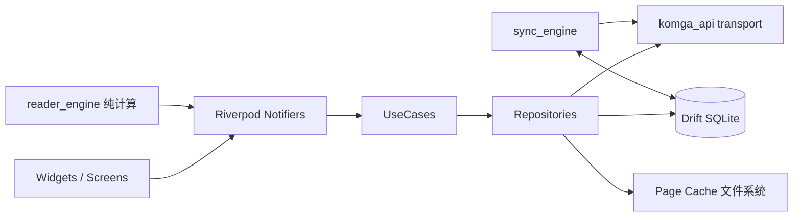

# KomgaNative 技术选型（v1.0，2026-11-17）

> 目标：iOS + Android 的 Komga 原生客户端，手机 / 平板 / 安卓墨水屏三形态适配，阅读体验为第一优先级，**全程由 AI Agent 开发**。
> 本文所有 Komga 接口结论基于官方 OpenAPI `1.30.1` 快照（本地已下载核对）；标注具体版本号的依赖均为 2026-11-17 当日 pub.dev / Flutter release 的实际最新稳定值。

---

## 0. 一页结论

| 层 | 选型 | 一句话理由 |
|---|---|---|
| 应用框架 | **Flutter 3.50（stable, 2026-11-11）+ Dart 3** | 单语言单构建系统、无头可验证、渲染可控，是"AI Agent 主导 + 图片密集型阅读器"的最优交集 |
| 状态管理 | **Riverpod 3.5（不用 codegen）** | 编译期依赖注入、可在纯 Dart 单测中构造 `ProviderContainer`，不依赖 Widget 树 |
| 路由 | **go_router 18.1** | 声明式、深链、状态恢复、无全局单例 |
| 本地库 | **Drift 2.35（SQLite）** | 类型安全 SQL + 响应式查询 + 迁移测试，天然适配离线/同步 |
| 网络 | **dio 5.11 + 自写拦截器** | 需要拦截器链：鉴权、重试、取消、证书 TOFU、请求预算 |
| API 层 | **OpenAPI 生成（`dart-dio`，按 tag 裁剪）+ 手写 Repository** | 用机器生成消灭"Agent 幻觉字段"，把手写面积压到最小 |
| 模型 | **freezed 4 + json_serializable** | 领域模型只出现在边界，生成代码隔离 |
| 测试 | `dart test` + `flutter test` + **黄金图（自建 harness）** + `integration_test` + Docker Komga 契约测试 | 让 Agent 能"看见"自己写的 UI，这是 AI 开发的关键 |
| 平台原生 | **只写 3 个薄插件**：墨水屏刷新、图片压缩编码、文件/分享 | 99% 代码保持纯 Dart，避免双端实现漂移 |
| 工程结构 | **Dart pub workspace 多包** | 包边界 = Agent 任务的物理边界，也是上下文预算的边界 |
| CI / 发布 | GitHub Actions（ubuntu 测、macos 建 iOS、windows 可选）+ FVM 锁 SDK + Fastlane | Windows 上开发，iOS 全靠 CI，必须从 M0 就打通 |
| 墨水屏 | 反射调用 Onyx EPD API + 通用降级档（无动画/高对比/整屏刷新） | 不引入闭源 AAR 依赖也能跑，AAR 仅作为可选构建变体 |

**一句话**：Flutter 单代码库 + 纯 Dart 领域层 + 三个薄原生插件 + OpenAPI 生成客户端 + 黄金图/契约测试闭环。

---

## 1. 需求推导：这个产品真正难在哪

把需求翻译成工程约束，才能判断选型。这个 App 的本质是：

> **一个远程图库的浏览器** + **一个高帧率图片查看器** + **一份可靠的阅读进度账本**。

按体验权重排序的难点：

| 排名 | 难点 | 为什么难 | 对选型的硬要求 |
|---|---|---|---|
| 1 | 阅读器（60% 体验） | 大图解码、内存、预加载、缩放平移、翻页手感、双页/RTL/条漫 | 必须有**自绘渲染 + 完整手势控制权** + 隔离线程解码 |
| 2 | 进度同步正确性（用户抱怨的核心） | 多设备并发、离线、退出即杀、页码基准、误标已读 | 必须有**本地持久队列（outbox）+ 可单测的纯逻辑状态机** |
| 3 | 墨水屏（差异化） | 刷新策略、残影、无动画、对比度 | 必须能**调用 Android 平台 API**，且渲染层可降级 |
| 4 | 多形态适配 | 手机/平板/折叠/墨水屏断点、双栏、安全区 | 声明式布局 + 可测试的多尺寸黄金图 |
| 5 | AI Agent 可维护性 | 上下文有限、易漂移、看不见运行时 | 小文件、强类型、包边界、**无头视觉验证** |

由此得出三条**被选型必须满足的前提**：

1. **渲染层可编程**：不能用 WebView/PWA 包装，不能依赖系统控件的默认行为。
2. **领域逻辑必须能脱离设备运行**：进度同步、布局计算、分页策略要能在 CI 里毫秒级跑完单测。
3. **UI 必须能被 Agent"看到"**：否则 Agent 只能盲写，靠人肉截图反馈，效率归零。

> 关于"原生"的定义：本项目的"原生"= 无 WebView、无 JS 桥、二进制交付、帧率与手势达原生水平；**不追求**逐像素复刻 UIKit 控件。因为阅读器 UI 是自有设计语言（这也是差异化的一部分），复刻系统控件反而没有价值。若你坚持 iOS 上系统控件的原生手感（分享面板、文本选择、滚动回弹、上下文菜单），代价是双端 UI 双写，见 §3 的翻转条件。

---

## 2. 候选方案评分

权重按本项目实际情况设定，"AI Agent 友好度"与"阅读器性能"并列最高。

| 评价维度 | 权重 | Flutter | RN + Expo | KMP + Compose MP | 双原生(SwiftUI+Compose)+共享核 | PWA/Capacitor |
|---|---|---|---|---|---|---|
| 阅读器性能与手势控制力 | 25% | 4.5 | 3.5 | 4.5 | 5.0 | 2.0 |
| **AI Agent 开发效率 / 可维护性** | 25% | 5.0 | 4.5 | 3.0 | 2.0 | 4.5 |
| 双端功能一致性（防漂移） | 15% | 5.0 | 5.0 | 5.0 | 2.5 | 5.0 |
| iOS 平台能力与上架可行性 | 10% | 3.5 | 4.0 | 4.0 | 5.0 | 2.0 |
| 平板 / 墨水屏适配 | 10% | 4.0 | 3.0 | 4.5 | 5.0 | 1.5 |
| 生态与长期维护 | 10% | 4.0 | 3.5 | 4.0 | 4.0 | 4.0 |
| 上手/招聘/资料量 | 5% | 4.0 | 4.5 | 3.0 | 2.5 | 4.5 |
| **加权总分** | | **4.48** | **4.03** | **4.03** | **3.65** | **3.35** |

### 2.1 细分：什么叫"AI Agent 友好度"

这是本项目的核心权重，展开打分依据（5 分制）：

| 子项 | Flutter | RN+Expo | KMP+CMP | 说明 |
|---|---|---|---|---|
| 单语言 / 单构建系统 | 5 | 4 | 2 | KMP 需要 Gradle + Xcode + (CocoaPods/SPM) 三套；iOS 链接错误对 Agent 近乎不可读 |
| **无头视觉验证**（能否生成并检查真实渲染截图） | 5 | 2 | 3.5 | Flutter 黄金图 = 真 Skia 渲染 + Agent 可以直接看图；RN 的 Jest 快照只是组件树文本；CMP 需 Roborazzi 额外搭 |
| 编译错误可自愈性 | 5 | 4 | 3 | Dart analyzer 报错定位精准、措辞友好；Gradle/Kotlin 多层堆栈消耗大量 turn |
| 增量构建速度 | 5 | 3.5 | 2 | Flutter 热重载秒级；KMP 冷构建常 2–5 分钟，Agent 迭代成本翻倍 |
| 工具链脆弱度 | 4.5 | 3.5 | 2.5 | pub 单命令 vs node_modules/metro/pods vs konan/xcframework 交叉编译 |
| 训练语料与 API 稳定性 | 5 | 3.5 | 3 | RN 生态 churn 大（New Architecture 强制、老库失修）；CMP iOS 语料相对少 |
| 生成代码可控性 | 5 | 4 | 4 | OpenAPI 生成 + 分析器隔离，三者都可做，Flutter 额外有 `flutter analyze` 一票否决 |

### 2.2 落选原因（要点）

- **RN + Expo**：`expo-image` 与 Reanimated 4 的 worklet 确实能把大多数交互做顺，但"超大手势驱动图片视图 + 精确内存预算 + 双页/RTL/条漫排版"需要大量原生模块兜底，一旦下沉到原生就失去跨端收益。更致命的是**依赖升级 Churn**：2026 年 RN 已强制 New Architecture（SDK 55 / RN 0.83 起无法回退），大量第三方库仍在迁移，Agent 面对"库与 RN 版本不兼容"这类问题极易陷入死循环。它的最大优势是 **EAS 云端构建 iOS（不需要 Mac）**，见 §3 翻转条件。
- **KMP + Compose Multiplatform**：技术上完全可行（[Komelia](https://github.com/Snd-R/Komelia) 已证明 Komga 域在 Kotlin 上跑得通，Android + 桌面共享核心；CMP iOS 自 1.8 起 stable，当前稳定版 1.12.x，1.13 仍在 beta）。但本项目全程 Agent 开发，`Gradle + Xcode + konan + 框架链接` 的组合会持续制造"人也要调半天"的失败模式；且 iOS 端 Compose 的键盘/滚动/返回手势仍需 Swift 兜底，单语言优势被削弱。
- **双原生 + 共享核心**：iOS 手感最好、墨水屏最直接，但**每个功能写两遍、测两遍**。对人是"两倍工作量"，对 Agent 是"两套漂移源 + 双倍 review 成本 + 规格二义性"。以本项目的功能密度（阅读器状态机、同步规则、手势配置），漂移风险不可接受。
- **PWA / Capacitor**：iOS 上无法保证大图内存与手势精度，后台下载、墨水屏刷新、文件管理全部受限，且与"原生支持 Komga"的定位冲突。

---

## 3. 决策与翻转条件（ADR-0001）

**决定**：采用 **Flutter 单代码库**，领域层（同步、分页、布局、缓存策略）用**纯 Dart 包**实现并可脱离 Flutter 测试；平台相关能力通过**三个薄插件**暴露（墨水屏刷新、图片编码、文件/分享）。UI 采用自有设计系统 + 自适应布局，不追求系统控件复刻。

**被否决的核心方案**：KMP+CMP（工具链复杂度对 Agent 不友好）、RN+Expo（阅读器性能上限与依赖 churn）、双原生（维护双写漂移）。

**翻转条件（任一成立就重开 ADR）**：

| 触发条件 | 改选 | 说明 |
|---|---|---|
| 明确要求"iOS 完全 UIKit 原生手感"（尤其社交/系统集成重度） | 双原生 UI + KMP 共享域层 | 代价：工期 +50%~80%，需放弃单端一致性收益 |
| 团队最终接手人只有 Kotlin/Android 背景且排斥 Dart | KMP + CMP | 技术可行，需额外投入 2~3 周打通 iOS 工具链并沉淀 Agent 排错手册 |
| 开发环境完全无法获得 macOS（含 CI 云 Mac），且 iOS 是首发硬需求 | RN + Expo（EAS 云构建） | 这是 RN 唯一压倒性优势；但需接受阅读器部分功能下沉原生 |
| M2 阶段实测：Flutter 在目标大图场景掉帧/内存超标且无法通过自绘优化解决 | 阅读器改为原生视图（Android 自定义 View / iOS UIScrollView）+ Flutter 混合 | 混合方案留作后备，不预先设计 |

---

## 4. 技术栈清单（逐项理由 + Agent 注意事项）

### 4.1 运行时与基础

| 依赖 | 版本（2026-11-17） | 用途 | Agent 注意点 |
|---|---|---|---|
| Flutter SDK | **3.50.0 stable** | 框架 | **版本锁定**（`.fvmrc`）；CI 与本地必须同版本，否则黄金图全红 |
| **material_ui** | **^1.11.1** | Material 组件 | ⚠️ **Flutter 3.50 起 `flutter/material.dart` 已废弃**，Material 拆成独立包；`go_router 18` 已依赖它。新代码一律 `import 'package:material_ui/material_ui.dart'` |
| Dart | 随 SDK（3.14.0） | 语言 | `analysis_options` 开 `strict-casts` / `strict-raw-types` / `strict-inference` |
| riverpod / flutter_riverpod | 3.5.0 | 状态与 DI | 手写 Provider（不上 codegen），减少 build_runner 面 |
| go_router | 18.1.4 | 路由/深链 | 用 `StatefulShellRoute` 做底部导航保活；阅读器用独立 root route 隐藏导航 |
| drift + sqlite3_flutter_libs | 2.35.4 | 本地库 | 用 `.drift` SQL 文件（Agent 写 SQL 比写 Dart DSL 更稳），迁移必须有 `drift_dev schema` 测试 |
| dio | 5.11.1 | HTTP | 统一 `CancelToken`；所有请求带 `X-API-Key`；错误映射为 `KomgaError` 密封类 |
| freezed + json_serializable | 4.0.3 | 领域模型/状态 | 仅用于**边界与状态**；DTO 由 OpenAPI 生成，不重复定义 |
| flutter_secure_storage | 11.2.0 | 凭据（Keychain/Keystore） | 只存 token/API Key/证书指纹，不存业务数据 |
| background_downloader | 9.6.6 | 后台下载（URLSession / WorkManager） | 或改用自写队列 + 前台服务；**M4 决策点**，见 §7.2 |
| cached_network_image / flutter_cache_manager | 最新 | 仅缩略图磁盘缓存 | 阅读器页图**不要**用这个包，走自研管线 |
| flutter_image_compress | 最新 | 下载时降采样重编码（JPEG） | Flutter 原生只能编码 PNG，必须插件；在 isolate 中调用 |
| 黄金图 | **自建轻量 harness**（`apps/app/test/golden/golden_harness.dart`） | 显式设尺寸/DPR、加载 Roboto + MaterialIcons、多主题矩阵；比 alchemist 少一层依赖，行为完全可控。矩阵复杂度上来后再评估 alchemist |
| device_info_plus / package_info_plus / connectivity_plus / share_plus / url_launcher | 最新 | 平台信息 | 设备形态判定输入之一 |
| flutter_localizations + intl | SDK | 中英双语 | ARB 文件，CI 校验缺失 key |

### 4.2 API 客户端：生成 + 手写混合

```
tool/
  komga-openapi-1.30.1.json     # 规格快照（入库，可复现）
  codegen.ps1 / codegen.dart    # 裁剪 tag 后生成
packages/komga_api/
  lib/generated/**              # 生成物，文件头 GENERATED，analysis 排除
  lib/src/transport.dart        # 鉴权、重试、取消、TOFU 证书、请求预算
  lib/src/repositories/**       # 手写：把 DTO 映射成领域模型 + 分页封装
```

- 用 `--global-property apis=BooksApi,SeriesApi,LibrariesApi,ReadListsApi,CollectionsApi,UsersApi,ReferentialApi` 裁剪，避免生成几百个端点拖垮分析器。
- 生成物**禁止手改**；`tool/codegen` 在 CI 中重跑并 `git diff --exit-code`，防止 Agent 偷偷打补丁。
- 每个 Repository 方法都要有"服务端版本能力探测"，见 §7.3。
- **测试夹具**：把真实 Komga（`gotson/komga` Docker）响应体抓进 `test/fixtures/*.json`，Agent 写 UI 时读夹具而不是猜字段。

### 4.3 工程结构：pub workspace 多包

```
KomgaNative/
├─ pubspec.yaml                 # workspace 根
├─ fvm_config / .fvmrc
├─ apps/app/                    # Flutter 应用（唯一可执行目标：android, ios）
├─ packages/
│  ├─ komga_api/                # 生成的 OpenAPI 客户端 + transport
│  ├─ domain/                   # 纯 Dart：实体、值对象、用例接口（零 Flutter 依赖）
│  ├─ sync_engine/              # 纯 Dart：outbox、冲突策略、对账（毫秒级单测）
│  ├─ reader_engine/            # 纯 Dart：分页/双页/RTL/条带布局计算、预取策略（不依赖 UI）
│  ├─ design_system/            # Flutter：token、组件、自适应断点、动效规格
│  └─ platform_plugins/         # 三个薄插件的 Dart 接口 + android/ios 实现
├─ docs/
│  ├─ tech-selection.md         # 本文
│  ├─ adr/                      # 架构决策记录
│  └─ spec/                     # 功能规格（Agent 的输入契约）
└─ tool/                        # ci.dart、codegen、夹具录制（跨平台 Dart 脚本）
```

**依赖方向（由 lint 强制）**：`app → (design_system, reader_engine, sync_engine, komga_api, domain, platform_plugins)`；`reader_engine / sync_engine → domain`；`domain → 无`。反向依赖一律 CI 失败。

为什么值得拆包（而不是单包分目录）：

1. `dart test` 跑纯 Dart 包无需 Flutter 引擎，单包测试常在 1 秒内完成 → Agent 反馈快。
2. 包 = Agent 任务的物理隔离边界，并行 Agent 不会撞文件。
3. `dart analyze packages/reader_engine` 输出极小，节省上下文。
4. 编译期阻止"UI 里直接写 HTTP"这类最典型的 Agent 走捷径行为。

### 4.4 本机环境现状（2026-11-17 已落地）

**已完成用户级安装（无需管理员），详见 [environment-setup.md](environment-setup.md)**：

| 组件 | 版本 / 路径 | 状态 |
|---|---|---|
| Flutter | 3.50.0 stable（Dart 3.14.0），`D:\DevTools\flutter\3.50.0` | ✅ 官方 zip + sha256 校验通过 |
| JDK | Temurin 17.0.21+9，`D:\DevTools\jdk-17` | ✅ sha256 校验通过 |
| Android SDK | cmdline-tools 21.0 / platform-tools 37.0.1 / platforms 35+36 / build-tools 35+36，`D:\DevTools\android-sdk` | ✅ 许可已接受 |
| `flutter doctor -v` | Asia/Shanghai，Windows 11 25H2 | ✅ **No issues found!** |
| 环境变量 | `JAVA_HOME` / `ANDROID_HOME` / `ANDROID_SDK_ROOT` + 用户 PATH 5 项 | ✅ 用户级，未改系统 |
| Windows 开发者模式 | 实测 `New-Item -ItemType SymbolicLink` 失败（需管理员） | ⚠️ **建议开启**（实测 pub get 与 build apk 均不需要，但个别插件会用到） |
| 系统长路径 `LongPathsEnabled` | 0（需管理员） | ⚠️ **建议开启**（实测构建产物路径会超过 260 字符，连删除都失败） |
| Android 模拟器 / 系统镜像 | 未装（约 1.5GB，可选） | ⏸ 用真机或后续补装 |
| Xcode / macOS | 无 | → iOS 构建走 CI（见 R1） |

工具链实测结论：**`flutter pub get` 与 `flutter build apk` 在本机都不需要开发者模式**（Flutter 3.50 + `path_provider` 冒烟验证，产出 153MB debug APK）；首次构建由 AGP 自动补装 NDK/CMake，冷构建 636 秒。

换机时只需两件事：`git clone` + 一条 `bootstrap.ps1`（约 30 分钟，含缓存搬运），因此双机开发的边际成本主要在两处——Android 签名密钥的保管，以及“离开机器前必须 commit & push”。

---

## 5. 架构分层与数据流



规则（写进 `AGENTS.md`，违者 CI 拦）：

1. **Widget 不做 I/O**，只读 Notifier 状态 + 发 intent。
2. **Repository 是唯一碰 `komga_api` 和 `dio` 的地方**。
3. **同步逻辑只存在于 `sync_engine`**，且全部纯函数/纯状态机，输入输出都是值对象。
4. **分页布局只存在于 `reader_engine`**，返回不可变的 `ReaderLayout`，Widget 只负责画。
5. 错误统一为 `sealed class AppError`（网络/鉴权/服务端/磁盘/取消/未知），UI 只 switch，不 catch 裸 `Exception`。
6. 所有跨包 API 用 `domain` 的模型，**不得把生成的 DTO 泄漏到 UI 层**。

数据流（打开一本书的读路径）：

```
点击书 → Repository.getBook(缓存优先, 后台刷新)
       → /books/{id}/pages 取每页 width/height/mediaType/sizeBytes（一次请求）
       → reader_engine.computeLayout(页尺寸, 屏幕尺寸, 模式/方向) → ReaderLayout
       → 预取窗口 [i-2, i+3] 页图：HTTP → 解码（IO 线程，目标尺寸）→ ImageCache(LRU, 字节预算)
       → 用户翻页 → 落定 1.5s 后 → sync_engine.enqueueProgress(bookId, page, completed)
                    → outbox 落库 → 后台 flush → PATCH /books/{id}/read-progress
```

---

## 6. Komga 原生支持设计（API 事实与策略）

已核对 `1.30.1` OpenAPI：**鉴权**支持 Basic Auth 或 `X-API-Key`；会话可用 `X-Auth-Token` 复用；**应用可自助创建 API Key**（`POST /api/v2/users/me/api-keys`），因此首登流程可以做到"输入地址+账号 → 自动创建名为 `KomgaNative-iOS` 的 Key → 只把 Key 存进 Keychain"，避免长期保存用户密码。

### 6.1 关键端点（详见附录 A）

| 用途 | 端点 | 备注 |
|---|---|---|
| 连接/版本探测 | `GET /actuator/info`、`GET /api/v1/settings`、`GET /api/v1/claim` | `claim` 未完成 = 服务器未初始化 |
| 书架 | `GET /api/v1/libraries`、`GET /api/v1/series`（search/library_id/read_status/tag/genre/publisher/language/status/complete/sort…） | 分页 `page`/`size`（0 基） |
| 继续阅读 | `GET /api/v1/books/ondeck`、`/api/v1/books/latest`、`/api/v1/series/latest` | `ondeck` = 系列内首个未读书 |
| 书详情 | `GET /api/v1/books/{id}`（含 `readProgress`、`media.pagesCount`、`media.mediaProfile`） | 列表响应同样带 `readProgress` |
| 页元数据 | `GET /api/v1/books/{id}/pages` | 每页 `width/height/mediaType/sizeBytes`（`width/height` **非必返**） |
| 页图 | `GET /api/v1/books/{id}/pages/{n}?convert=jpeg&zero_based=false` | **只支持 jpeg/png**，**没有 resize 参数** → 降采样必须在客户端做 |
| 原始页 | `GET /api/v1/books/{id}/pages/{n}/raw` | 无损，体积大 |
| 缩略图 | `/books/{id}/thumbnail`、`/books/{id}/thumbnails`、`/series/{id}/thumbnail` | 占位图/书架用 |
| 进度写 | `PATCH /api/v1/books/{id}/read-progress` body `{page?, completed?}` | `page` **1 基**；`completed` 省略时服务端按页数自动判定 |
| 进度删 | `DELETE /api/v1/books/{id}/read-progress` | 标为未读 |
| 系列级进度 | `PATCH /api/v1/series/{id}/read-progress` | 整系列标记已读 |
| 标准定位 | `PUT/GET /api/v1/books/{id}/progression`（Readium OPDS2） | EPUB/Divina 位置；漫画不是必须，v2 再评估互通 |
| DiViNa 清单 | `GET /api/v1/books/{id}/manifest/divina` | Readium 标准阅读顺序，可作为阅读器数据模型的可选来源 |
| 前后书 | `GET /api/v1/books/{id}/next`、`/previous` | 读完自动跳下一本 |
| 集合/书单 | `/api/v1/collections`、`/api/v1/readlists` | 书架分组 |

**为什么不用 Kobo 同步协议 / OPDS**：Kobo 通道是给 Kobo 设备准备的，进度模型受限；OPDS 适合浏览不适合精细进度与下载管理。REST 是唯一能完整表达"页级进度 + 本地离线 + 多设备对账"的通道。OPDS 仅作为可选导出/互通。

### 6.2 三种媒体统一处理（重要范围收敛）

Komga 的 `/pages/{n}` 对 **CBZ / CBR / PDF / Divina-EPUB** 一视同仁地输出图片。因此 v1 的阅读器**只实现"图片序列"一种模型**即可覆盖全部漫画与 PDF，不需要在客户端集成 PDF 渲染器或 RAR 解压库（CBR 离线下载也走页图缓存，而不是下原文件）。

例外：**可重排 EPUB**（纯文字）不在 v1 范围，需要文字排版引擎；若要做，走 Readium + `/manifest/epub`，作为 v2 独立模块。

### 6.3 连接与安全

| 场景 | 策略 |
|---|---|
| HTTP 明文自建服务器 | Android：`usesCleartextTraffic=true`（用户可填任意地址，无法做域名白名单），UI 明确提示风险；iOS：真机验证 ATS，必要时 `NSAllowsArbitraryLoads` + 审核说明 |
| 局域网发现 | iOS 14+ 需要 `NSLocalNetworkUsageDescription`，首次连接触发系统授权，必须在引导里解释 |
| 自签名证书 | TOFU：首次连接展示 SHA-256 指纹让用户确认，指纹存 secure storage，`badCertificateCallback` 校验；支持随时撤销 |
| 反向代理 Basic Auth | 作为"服务器级附加认证头"可选配置 |
| 凭据存储 | API Key → Keychain / Keystore；不落 SQLite、不进日志（日志过滤器统一脱敏） |
| 多服务器 | 支持多 profile，每个 profile 独立 DB namespace 与缓存目录 |

---

## 7. 三个核心子系统设计要点

### 7.1 阅读器引擎（决定产品成败）

**分层**：`reader_engine`（纯 Dart 计算）→ `ReaderController`（状态机 + 事件）→ `ReaderView`（绘制）。

#### (a) 版面模型

```dart
enum ReadingMode { paged, doublePage, verticalScroll }
enum FitMode { contain, fitWidth, fitHeight, original }

// 纯计算输出，可单测
class ReaderLayout {
  final int pageIndex;         // 当前逻辑页
  final Rect contentRect;      // 页面在视口中的矩形（已含缩放/偏移）
  final double minScale, maxScale, currentScale;
  final List<int> visiblePages; // 双页模式返回两个
}
```

- 缩放区间：`fitScale … max(fitScale*4, 1.0)`（1.0 = 1 物理像素对 1 逻辑像素）。
- 双页规则：`isWide(page) = w/h > 1.2` 的页单独成页；封面是否单独（`coverSolo`）可配置；RTL 时**视觉顺序反转**、翻页手势方向反转。
- 阅读方向优先级：书级覆盖 > 系列 `metadata.readingDirection`（服务端下发，天然跨端同步）> 全局默认。
- 条漫模式：`fitWidth` + 虚拟化长列表，按累计高度定位，禁止整幅缩放（只允许 2x 局部放大）。

> 注：`readingDirection` 在 OpenAPI 中为无枚举约束的 string，实际取值需 M0 阶段连真实服务器确认并写成夹具测试。

#### (b) 手势状态机（必须可确定性单测）

状态：`idle → pressing → (panning | turning | zooming) → settling → idle`

不变量（写成测试用例）：

1. `scale > fitScale + ε` 时拖动**只平移**，到达边缘后继续拖动才可翻页（可配置"边缘翻页"）。
2. 双指缩放以焦点为锚点，缩放过程中不触发翻页；手指从 2 变 1 时重新定基准。
3. 翻页判定：位移 > 25% 视口宽 **或** 速度 > 300 px/s；未达阈值回弹（弹簧，不是线性）。
4. 首/末页：橡皮筋阻尼；越界回弹动画在墨水屏上禁用。
5. 双击：`fit ↔ 2.5x`，第二次双击回 fit 并居中。
6. 连续翻页（快速滑动）合并为一次最终页落定，**只写一次进度**。

实现建议：手势用 `RawGestureDetector` + 自定义 `ScaleGestureRecognizer` 子类（同时处理平移与缩放），动画用 `AnimationController` + `SpringSimulation`；**不要**用 `InteractiveViewer`（内部状态不可控、双页与边缘翻页无法插入）。

#### (c) 解码与缓存管线（内存是第一风险）

```
请求页 n
  → 命中 LRU(ui.Image) ? 直接绘制
  → 否则 HTTP（若 PageDto.sizeBytes 大且原格式非 JPEG → 追加 &convert=jpeg）
  → 字节流写临时文件 / 内存
  → ui.ImmutableBuffer.fromUint8List → ui.ImageDescriptor.encoded(...).instantiateCodec(targetWidth/Height, allowUpscaling:false)  // IO 线程
  → 得到 ui.Image → 入 LRU → 通知重绘
```

关键策略：

| 项 | 决策 | 理由 |
|---|---|---|
| 降采样时机 | 解码期（`targetWidth/Height`），而非绘制期缩放 | 内存占用与像素数成正比；绘制期缩放无效 |
| 何时请求 `?convert=jpeg` | `mediaType != image/jpeg` 且 `sizeBytes > 1.5MB`，或用户开"省流" | PNG 解码降采样在部分实现仍整幅解码，内存尖峰大；JPEG 可低成本缩放解码。代价是服务端 CPU，需可关闭 |
| 内存预算 | `min(0.25 × 进程可用堆, 320MB)`；墨水屏设备取 0.15 与 160MB | 低端 Android 与 Boox 内存差异极大 |
| LRU 淘汰 | 按字节计数淘汰，永不淘汰"当前 + 预取窗口" | 避免翻页抖动 |
| 预取窗口 | 分页：前 2 / 后 3；双页：前 1 对 / 后 2 对；条漫：上下各 2 屏 | 局域网延迟低，重点是解码吞吐 |
| 取消 | 每次快速翻页递增 generation token，过期请求 `CancelToken.cancel()` | 防止"翻 10 页后 10 个解码任务同时回填" |
| 占位 | 先用 `/books/{id}/thumbnail` 模糊填充（服务端已生成，几乎免费） | 首帧感知速度 |
| 超大页 | 分辨率阶梯：fit 时用 1x 视口解码，放大超过 1.8x 时按需重解码高分辨率并交叉淡入 | 避免一次解码 4000×6000 |
| 内存压力 | `didHaveMemoryPressure` → 清空非可见页 | Android 低内存必踩 |
| 长图（条漫单页超高） | 按图块（tile）切分绘制，单 texture 上限 4096 兜底 | GPU 纹理上限 |

性能预算（写进验收）：

| 指标 | 目标 |
|---|---|
| 已缓存页翻页首帧 | < 50ms（120Hz 设备不掉帧） |
| 局域网未缓存页可见（局域网 1Gbps/NAS） | p95 < 400ms |
| 阅读器内存峰值（4GB 设备） | < 350MB |
| 连续翻 30 页丢帧率 | < 1% |
| 冷启动到书架可交互 | < 2.5s（热 1.2s） |

#### (d) 墨水屏渲染路径

- 检测：`platform_plugins` 的 `EinkInfo`（厂商：Onyx/Hisense/Moaan/其他）+ 用户手动开关；检测失败不阻塞，只影响默认档。
- 渲染降级：关所有过渡/阴影/模糊/渐变/涟漪；`disableAnimations` 时全区零时长；对比度增强（绘制时 `ColorFilter` 或预置曲线），可切灰度。
- 翻页：直接换图 + **请求整屏刷新**（E-ink 残影关键）。Onyx 走反射调用 EPD 刷新模式接口（`EpdController` / `Device` 一类，具体类名以实际 SDK 为准；SDK 未上 Maven Central，实测检索为空，见 §10 R3），非 Onyx 设备退化为"少动画 + 依赖系统优化"。
- 布局：默认单页 `contain`；10.3" 以上横屏默认双页；底部栏大按钮，减少精确点击需求。
- 功耗：禁止自动预取超过 2 页、禁止后台解码。

### 7.2 同步与离线（用户抱怨的核心，必须做对）

**原则**：**服务端是唯一真相源（SSOT）**，客户端是"可离线写入的缓存 + 待提交队列"。不引入自建同步服务，跨平台同步天然由 Komga 完成。

#### (a) 写路径（outbox 模式）

```
翻页落定(1.5s 防抖) / 退出阅读器 / 应用进入后台 / 手动标记
  → 计算 targetPage(1 基) 与 completed
  → 与本地已知的 lastAcked 比较：相同则丢弃（幂等）
  → 写 outbox（bookId 唯一键，同书只保留最新一条，合并）
  → 立即更新本地 readProgress（乐观 UI）
  → flush：按 bookId 串行，PATCH → 204 → 记录 serverAckAt，出队
  → 失败分类：网络/5xx → 指数退避重试；401 → 暂停并提示重登；404 → 书已删除，清理本地
```

**必须避免的现有客户端通病**（对应用户痛点）：

| 通病 | 我们的对策 |
|---|---|
| 把页码当 0 基，导致进度差一页 | 全链路 1 基；`PageDto.number` 与 API 一致；单测锁定 |
| 一打开书就写 page=1，未读书变"在读" | 仅当 `page > 1` 或停留 > 10s 或翻过页才写 |
| 翻页时高频写，刷爆服务器 | 1.5s 防抖 + 同书合并 + 退出时强制 flush（`AppLifecycleState.paused`） |
| 进程被杀导致最后几页丢失 | outbox 先落 SQLite 再发网络；app 启动即 flush |
| 离线阅读的进度不同步 | outbox 持久化，联网自动补发 |
| 到最后一页没标已读（或误标） | 到末页显式 `completed:true`；手动"标为已读/未读"入口 |
| 多设备互相覆盖，不知道信谁 | 见下：三方对账 + 明确提示 |

#### (b) 读路径与冲突

对每本书维护三元组：`localPage/localCompleted`、`localBaseServerLastModified`（上次确认时的服务端值）、`pendingOutbox`。

```
拉取最新 readProgress：
  if 有 pending：以本地为准继续提交（后写者胜），提交成功后 base 更新
  else if server.lastModified == localBase：无变化
  else if server.lastModified > localBase：
         server.page > local.page → 采纳服务端（另一设备读得更远），提示"已同步到第 N 页"
         server.page < local.page → 可能是重读：比较 readDate，服务端更新则采纳，否则保留本地并下次提交
  if book 被标记完成而本地未完成 → 采纳完成态，但不自动跳页
```

- **永不用设备墙钟做判据**，只用服务端 `readProgress.lastModified` + 单调的本地序列号；避免时钟漂移导致互相覆盖。
- 分页策略：阅读器内只做"同书串行 flush"；全局最多 3 个并发 flush。
- 前台恢复时增量对账：先刷 `ondeck`、当前系列、当前书，再按需刷新列表页（不整库拉取）。

#### (c) 离线内容

- **页级缓存**（推荐主路径）：`/pages/{n}` 逐页下载落盘 + 清单 JSON（`sizeBytes` 校验、宽高、格式）。优势：格式无关（CBR/PDF 同样支持）、可断点续传页、可按设备降采样、天然支持"部分下载"。
- 存储优化：若页面像素 > 阈值，下载时用 `flutter_image_compress` 降采样重编码（例如目标 = 屏幕宽 × 2），可省 3–5 倍空间；这是墨水屏（CPU 弱）能流畅翻页的关键。原始质量保留为可选档。
- 任务调度：并发 3、失败重试、Wi-Fi only、电量保护；Android 前台服务（`dataSync` 类型）或 WorkManager，iOS 用 URLSession 后台任务。
- 清理：按"系列/单本"粒度 LRU + 手动置顶保留；设置页显示占用与批量清理。
- 一致性：`sizeBytes` 不符则重下；书被服务端删除 → 本地标记 orphan，保留阅读进度直到用户确认。

### 7.3 设备形态适配

| 形态 | 判据 | 布局 | 阅读器默认 |
|---|---|---|---|
| 手机竖屏 | width < 600dp | 单列网格 2–3 列 | 单页 contain，单手握持翻页区 |
| 手机横屏 | width < 900dp 且短边 < 600 | 列表详情可双栏 | 双页（可选） |
| 平板 | 600 ≤ width < 1024 | `NavigationRail` + 双栏列表/详情 | 双页 contain |
| 大平板/桌面级 | ≥ 1024 | 三栏（rail + list + detail） | 双页 + 边距 |
| 折叠屏 | `MediaQuery.displayFeatures` 含铰链 | 铰链感知分栏/避让 | 展开态按平板 |
| 墨水屏 | 厂商探测或手动 | 单列大间距、无阴影 | 单页 + 整屏刷新 |

其它细则：

- 断点常量集中在 `design_system/breakpoints.dart`，**禁止魔法数字散落**；每个断点组合都有黄金图。
- 安全区：`SafeArea` + `viewPadding`；横屏刘海两侧避让；手势导航条底部留白。
- 方向：阅读器可锁定；跟随系统 `Orientation`；iPad 支持多窗口（可选）。
- 无障碍：`textScaler` 1.0/1.3/2.0 三档黄金图；对比度、语义标签、`disableAnimations` 尊重系统开关。
- 高刷：120Hz 设备不做额外配置，但动效必须用物理弹簧而非固定时长，才能"跟手"。

---

## 8. AI Agent 工程化（本项目最容易被低估的部分）

选型再对，没有工程约束也会退化成"每天修 Agent 制造的回归"。以下是与选型配套的**制度性设计**。

### 8.1 仓库即契约：`AGENTS.md`

必含内容（骨架见附录 B）：

1. **命令单一入口**：`dart run tool/ci.dart check`（analyze + format check + test + golden verify）；`dart run tool/ci.dart fix`；跨平台（Windows/Linux/macOS 都能跑，不写 .sh）。
2. **架构不变量**：§5 的 6 条依赖规则 + "生成目录禁止手改" + "禁止新增依赖"。
3. **Definition of Done**（每次任务必须勾选）：新增/修改的纯逻辑有单测；新增 UI 有黄金图且已人工/视觉复核；涉及 API 的有夹具更新的契约测试；`dart run tool/ci.dart check` 全绿；更新 `docs/spec/*.md` 中对应段落。
4. **反模式清单**：不写 `dynamic`；不 `catch (_)`；不在 Widget 里 `await` 网络；不复制粘贴第二个"辅助类"；单文件 > 350 行需拆分说明。

### 8.2 让 Agent"看见" UI（最关键的能力）

- **黄金图即截图**：`flutter test --update-goldens` 产出的 PNG 存在 `test/goldens/`，多模态 Agent 可直接 `read_image` 检视，判断"是否溢出/错位/主题错误"。
- **三套矩阵**：设备尺寸（390×844 / 834×1112 / 758×1024 e-ink）× 主题（light/dark/eink）× 文本缩放（1.0/1.3）。命名规范化：`series_detail@tablet_dark_1.3.png`。
- **黄金图平台固定**：字体栅格化跨平台有差异。因为开发机是 Windows 且本机未装 Docker，规范定为 **Windows 为唯一基线平台**（CI 的 golden job 跑 `windows-latest`），本地 `--update-goldens` 产出可直接当基线；将来若团队迁到 macOS/Linux 主导，再切 Linux 容器基线并全量重生成。测试里显式加载 Inter/Noto Sans SC，避免默认测试字体变成方块。
- **差分产物上传为 CI artifact**：Agent 拿到 diff 图 + `ImageDiff` 百分比，能自我修正而不是等人。
- **运行期截图兜底**：`integration_test` 在模拟器上跑关键流程并截屏（`binding.takeScreenshot`），覆盖黄金图无法覆盖的滚动/手势后状态。

### 8.3 任务切片与并行

- 采用**纵向切片**：一个切片 = 一个 spec 段落 + 一条数据路径贯通（repo → notifier → widget → golden），控制在 ~400–800 行 diff。
- 并行时按**包/目录**分派：Agent A 改 `reader_engine`，Agent B 改 `design_system`，禁止跨边界同时改同一文件；接口先行（先落 `domain` 的接口与测试桩），再并行实现。
- 每个切片有**验收脚本**：`dart run tool/verify.dart --slice reader-paged-v1`，跑该切片的测试子集 + 黄金图 + 契约测试，输出结构化 JSON 供上层 Agent 汇总。
- 复杂决策（阅读器手势、同步冲突）**先写 spec 再写码**，spec 里带状态机图表和测试用例表；禁止"边写边想"，那是 Agent 最贵的失败模式。

### 8.4 防漂移门禁（CI 必过）

| 门禁 | 实现 |
|---|---|
| 编译/静态检查 | `dart analyze --fatal-infos`（生成目录排除） |
| 格式 | `dart format --set-exit-if-changed` |
| 生成代码同步 | 重跑 codegen，`git diff --exit-code` |
| 依赖白名单 | 脚本解析所有 `pubspec.yaml`，与 `docs/deps.md` 白名单比对，新增必须走 ADR |
| 分层校验 | `custom_lint` 规则：`domain` 不得 import flutter/dio；`app` 的 widget 不得 import `komga_api` |
| 单测/黄金图 | `dart test`（全 workspace）+ `flutter test` |
| 契约测试 | `docker run gotson/komga` 起真实服务器，跑登录/分页/进度/页图用例 |
| 体积与性能 | Android release 包体积基线；阅读器基准测试（`flutter drive` + `frameTiming`）阈值 |

### 8.5 Agent 的真实短板与对策

| 短板 | 对策 |
|---|---|
| 会"发明" API 字段/参数 | 生成客户端 + 夹具 + 契约测试三重约束 |
| 会过度抽象（工厂的工厂） | 规则：抽象只在出现**第三个**调用点时引入；评审清单里显式检查 |
| 会忽略平台差异（iOS 滚动回弹、返回手势） | `platform_plugins` 适配层 + 平台差异黄金图 + 真机 smoke 清单 |
| 不会调手势/动画时序 | 状态机纯函数化 + 时间注入（`Ticker` 可 mock）+ 帧序列单测 |
| 会"为了让测试过"改断言 | 测试文件变更需与实现变更分开提交，评审强制看 diff；黄金图必须人工确认基线更新 |
| 上下文塞不下大文件 | 单文件 ≤ 350 行、单包 ≤ 15 个公开类型；`docs/spec` 提供精确入口 |

---

## 9. 里程碑与验收

| 阶段 | 内容 | 验收（可自动化部分） | 粗估 Agent 任务数 |
|---|---|---|---|
| **M0 地基**（1 周） | workspace、CI、FVM、设计 token、路由骨架、Drift 骨架、OpenAPI codegen 流水线、Docker Komga 夹具、黄金图矩阵跑通、**Boox 真机 Impeller 冒烟** | `ci.dart check` 全绿；黄金图 3 形态 × 2 主题；契约测试对真实 Komga 通过 | 8–12 |
| **M1 连接与书架**（1.5 周） | 服务器配置/登录/API Key 自助创建/TOFU 证书；库/系列/书 列表+搜索+筛选+排序+分页；缩略图缓存；下拉刷新；空态/错误态 | 断网、401、404、慢网三态 UI 黄金图；分页游标测试 | 10–14 |
| **M2 阅读器 v1**（2 周） | 单页/双页 + 缩放平移 + 点击区 + 预取 + 内存预算 + 进度写入（outbox） + 阅读设置面板 | 手势状态机单测覆盖 6 条不变量；内存/帧率基准达标；进度写幂等测试 | 14–18 |
| **M3 阅读体验**（1.5 周） | RTL/条漫/双页规则/封面单独/方向继承系列元数据/亮度/常亮/白底黑字/隐藏 UI/快速跳页/缩略图导航 | 布局计算表格化单测（30+ 用例）；方向黄金图 | 10–14 |
| **M4 同步与离线**（2 周） | outbox 冲突策略、后台 flush、多设备对账提示、下载队列、页级缓存、存储管理、离线书架 | 双设备并发模拟测试（两台"虚拟设备"共享 mock 服务器）；断网/恢复/被杀三场景 E2E | 12–16 |
| **M5 形态适配**（1.5 周） | 平板/折叠三栏、墨水屏档位、Onyx 刷新反射、对比度/灰度、大按钮布局、手写/翻页键映射 | 6 组黄金图；Boox 真机残影/翻页主观验收单 | 10–12 |
| **M6 打磨发布**（1.5 周） | 引导、i18n 完整、无障碍、崩溃上报（可选自托管 Sentry）、TestFlight/Play 内测、发布自动化、性能回归基线 | 审核清单、Privacy Manifest（iOS 必填）、包体积基线 | 8–12 |

总计约 **10–12 周**（多个 Agent 并行可压缩到 6–8 周），与"全 AI 开发"节奏相符。

**M0 已完成（2026-11-17）**：pub workspace + 7 包、三套主题、阅读器几何/同步决策两个纯逻辑包、
OpenAPI 传输层骨架、`tool/ci.dart` 四段门禁、5 张黄金图、61 个测试全绿、Android debug APK 构建通过。
实测结论：`flutter/material.dart` 已废弃 → 全面切到 `material_ui`；黄金图确实抓到了"1.3 倍字号下书架卡片溢出"这类真实 bug。

---

## 10. 风险登记册

| # | 风险 | 概率 | 影响 | 缓解 | 触发/检查点 |
|---|---|---|---|---|---|
| R1 | 无 macOS，iOS 构建/调试只能靠 CI，迭代慢、问题定位难 | 高 | 中高 | M0 就打通 GitHub Actions macOS 构建 + TestFlight；iOS 专属代码控制在 5% 内；必要时租云 Mac（MacStadium/MacInCloud）按月 | M0 结束必须有一次成功的 TestFlight 包 |
| R2 | Impeller 在墨水屏设备（Boox）上出现残影/花屏 | 中 | 高 | M0 立刻真机冒烟；备选：AndroidManifest `io.flutter.embedding.android.EnableImpeller=false` 回退 Skia；墨水屏档位强制少动画 | M0 真机通过；否则启用回退 |
| R3 | Onyx 刷新接口不可用（SDK 未上 Maven Central，需 AAR 或反射） | 高 | 中 | 反射实现 + 能力探测 + 降级档；AAR 仅 Sideload 变体；UI 说明"系统优化设置" | M5 前完成 PoC |
| R4 | 大图 OOM（Android 低端机/超清扫描） | 中高 | 高 | 解码期降采样 + 字节预算 LRU + `convert=jpeg` + 分辨率阶梯 + 内存压力回调 | M2 用 300 页 4K 扫描压测 |
| R5 | 进度同步多设备互相覆盖 | 中 | 高 | outbox + 服务端 lastModified 对账 + 明确提示 + 双设备模拟测试 | M4 完成前回归 |
| R6 | 服务端 `convert=jpeg` 造成 NAS CPU 压力 | 中 | 低 | 默认关闭/按需触发（大 PNG、省流开关），带宽与 CPU 折中可配 | M2 实测转换耗时 |
| R7 | App Store 审核（自建服务器 + HTTP + 阅读器类） | 中 | 高 | 审核备注提供 demo 服务器；解释 ATS 例外；无 IAP；准备隐私清单 | M6 前预审自查 |
| R8 | Komga 版本差异导致接口不兼容 | 中 | 中 | 连接时探测版本 + 能力矩阵；最低支持版本明确（建议 ≥1.10）；契约测试跑 LTS 与最新两个版本 | M1 完成能力探测层 |
| R9 | Agent 引入未审依赖 / 漂移 | 高 | 中 | 依赖白名单 CI + ADR 流程 + 分层 lint | 长期 |
| R10 | Boox 等设备分发渠道（部分无 Play 商店） | 中 | 中 | GitHub Releases 提供 APK + F-Droid 可选；Play 内测轨道并行 | M6 |

---

## 11. 明确不做（v1 范围外）

- 可重排 EPUB 阅读器（纯文字排版）、漫画之外的文档。
- 服务端管理功能（扫描、元数据编辑、用户管理）——只做只读浏览 + 进度写，管理员功能引导到 Web UI。
- 自建同步服务/账号体系（服务端即真相源）。
- 桌面端（Windows/macOS/Linux）——Flutter 有能力，但 v1 不投入。
- OPDS/Kobo 协议、Tachiyomi 扩展生态兼容（`/read-progress/tachiyomi` 端点仅作观察）。
- 页面缓存之外的"整库镜像"离线模式。

---

## 12. 需要你拍板的 3 个点

1. **有没有 Mac 可用**（或愿意付费云 Mac）？没有的话，iOS 的调试闭环只能靠 CI + TestFlight，需要在 M0 追加"iOS 反馈链路"设计（截图回传、TestFlight 自动分发）。
2. **是否接受"自有设计语言"而非 iOS 系统控件复刻**？接受 → Flutter 方案按本文执行；不接受 → 需重开 ADR，走双原生。
3. **v1 是否需要 EPUB（可重排）/ PDF 之外的格式**？当前设计把 PDF/CBR/CBZ/Divina-EPUB 统一为图片序列，成本最低；若要文字版 EPUB，需额外 2–3 周并引入 Readium 类库。

---

## 附录 A：Komga API 速查（1.30.1）

| 类别 | 端点 |
|---|---|
| 鉴权 | `POST /api/v2/users/me/api-keys`、`GET /api/v2/users/me`、`POST /api/v1/login/set-cookie`、`POST /api/logout` |
| 发现 | `GET /actuator/info`、`GET /api/v1/settings`、`GET /api/v1/claim`、`GET /api/v1/announcements`、`GET /api/v1/releases` |
| 库 | `GET /api/v1/libraries`、`GET /api/v1/libraries/{id}` |
| 系列 | `GET /api/v1/series`、`GET /api/v1/series/{id}`、`GET /api/v1/series/{id}/books`、`/api/v1/series/latest`（同样有 new / updated）、`GET /api/v1/series/{id}/thumbnail` |
| 书 | `GET /api/v1/books`、`POST /api/v1/books/list`、`GET /api/v1/books/ondeck`、`GET /api/v1/books/latest`、`GET /api/v1/books/{id}`、`/api/v1/books/{id}/next` 与 `/previous`、`GET /api/v1/books/{id}/thumbnail`、`GET /api/v1/books/thumbnails` |
| 阅读 | `GET /api/v1/books/{id}/pages`、`GET /api/v1/books/{id}/pages/{n}`、`.../raw`、`.../thumbnail`、`GET /api/v1/books/{id}/manifest/divina`、`GET /api/v1/books/{id}/positions`、`/api/v1/books/{id}/progression`（GET 与 PUT） |
| 进度 | `PATCH` 与 `DELETE`：`/api/v1/books/{id}/read-progress`、`PATCH /api/v1/series/{id}/read-progress`、`GET /api/v1/history` |
| 集合/书单 | `GET /api/v1/collections`、`GET /api/v1/readlists`、`GET /api/v1/readlists/{id}/books` |
| 参考数据 | `GET /api/v1/genres`、`/tags`、`/publishers`、`/languages`、`/age-ratings`、`/authors` |
| 可选管理 | `POST /api/v1/libraries/{id}/scan`、`POST /api/v1/books/import`、`GET /api/v1/tasks` |

分页语义：`page` 从 0 开始，`size` 默认 20，响应为 Spring `Page` 结构（`content/totalElements/totalPages/number/size/first/last`）。
`read_status` 取值：`UNREAD | READ | IN_PROGRESS`（数组可多选）。
`mediaProfile`：规格里是无枚举约束的字符串（代码中应为 `DIVINA` / `EPUB` / `PDF`，M0 用真实响应写进夹具确认），用于判断是否需要走特殊阅读器。

---

## 附录 B：`AGENTS.md` 骨架

```markdown
# KomgaNative — Agent 工作契约

## 命令
- 全量校验：`dart run tool/ci.dart check`
- 自动修复：`dart run tool/ci.dart fix`
- 单包测试：`dart test packages/sync_engine`
- 黄金图更新：`flutter test --update-goldens`（基线平台 = Windows，与 CI golden job 一致）
- 契约测试：`dart run tool/ci.dart contract`（需 docker 起 gotson/komga）

## 架构不变量（违反即失败）
1. `packages/domain` 不得 import flutter / dio / drift。
2. Widget 层不得 import `komga_api`，不得直接网络 I/O。
3. `lib/generated/**` 为生成代码，禁止手改；改 API 请改 `tool/komga-openapi-*.json` 后重跑 codegen。
4. 禁止新增第三方依赖，除非 `docs/adr/` 有新记录且 CI 白名单更新。
5. 禁止 `dynamic`、裸 `catch`、`print`；日志走 `AppLog` 并脱敏。

## 完成定义（DoD）
- [ ] 纯逻辑有单测，覆盖新增分支
- [ ] 新 UI 有黄金图，且已用 `read_image` 自查
- [ ] 涉及 API 的变更同步更新 `test/fixtures/`
- [ ] `dart run tool/ci.dart check` 全绿
- [ ] `docs/spec/<feature>.md` 已更新

## 写作规范
- 单文件 ≤ 350 行；单类 ≤ 300 行；公开 API 必须有 doc 注释。
- 抽象只在第三个调用点出现时引入。
- 错误用 `AppError` 密封类表达，禁止字符串错误。
```

---

## 附录 C：参考

- Komga API 文档与规格：[komga.org/docs/openapi](https://komga.org/docs/openapi/komga-api)、[openapi.json](https://raw.githubusercontent.com/gotson/komga/refs/heads/master/komga/docs/openapi.json)
- 阅读进度语义与 Tachiyomi 兼容端点：见规格 `ReadProgressUpdateDto` / `/api/v2/series/{seriesId}/read-progress/tachiyomi`
- Flutter Impeller：<https://docs.flutter.dev/perf/impeller>
- Compose Multiplatform iOS 稳定性：<https://github.com/jetbrains/kotlin-multiplatform-dev-docs>
- 既有 Komga 客户端对照：[Komelia](https://github.com/Snd-R/Komelia)（KMP，Android/桌面）、[KMReader](https://apps.apple.com/app/kmreader/id6755198424)（Apple 平台原生）
- Onyx（Boox）Android SDK 示例：<https://github.com/onyx-intl/onyxandroiddemo>
